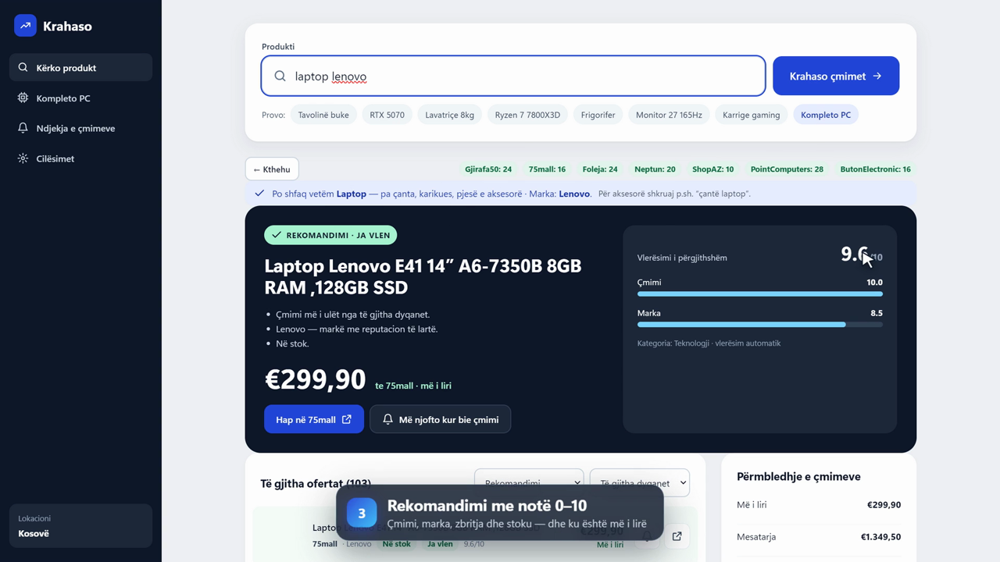
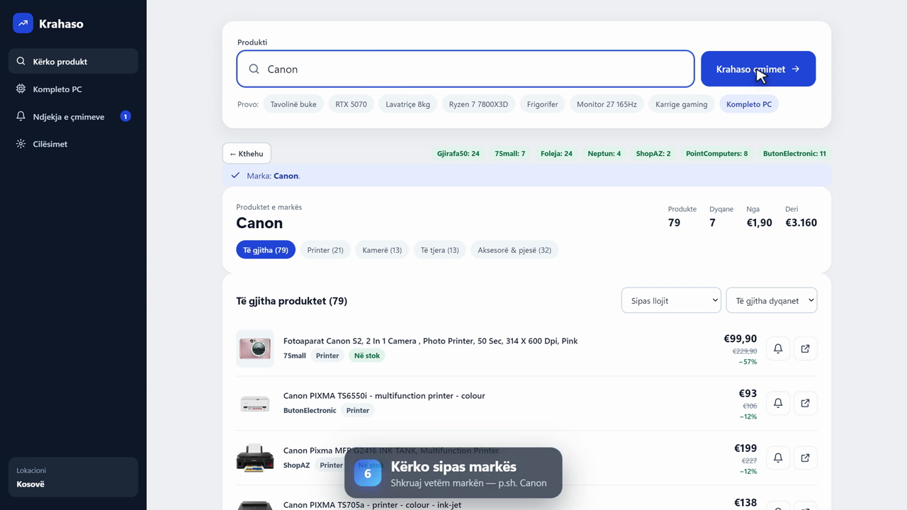
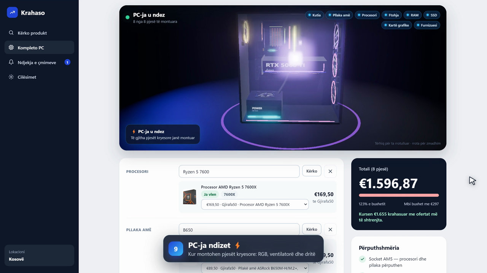

# Krahaso

**Krahaso çmimet nëpër dyqanet online në Kosovë — dhe merr rekomandimin më të mirë në pak sekonda.**

Krahaso kërkon njëherësh në disa dyqane online (Gjirafa50, 75mall, Foleja, Neptun, ShopAZ, PointComputers, ButonElectronic…), i lexon çmimet dhe të tregon ku është produkti më i lirë, cilën ofertë ia vlen ta marrësh dhe pse. Ka edhe një asistent për të kompletuar PC-në brenda buxhetit, me një kompjuter 3D që montohet live.

Funksionon si **aplikacion desktop (Windows)** dhe si **faqe web** — i njëjti kod, i njëjti dizajn.

🎬 **Videoja demo:** [video/Krahaso-demo.mp4](video/Krahaso-demo.mp4)



## Çfarë bën

- **Kërkim i zgjuar sipas llojit** — "laptop" tregon vetëm laptopë (jo çanta, karikues, RAM për laptop); "kompjuter" / "computer" / "pc" tregon vetëm kompjuterë të plotë. Për aksesorë shkruaje qartë, p.sh. "çantë laptop". Njëjtë për telefona, TV, monitorë, printerë, lavatriçe, frigoriferë, kondicionerë.
- **Kërkim sipas markës** — shkruaj vetëm markën (Canon, Midea, Samsung…) dhe shfaqen të gjitha produktet e saj, të ndara sipas llojit.
- **Rekomandim me notë 0–10** — nga çmimi, marka, zbritja, stoku; për pjesë PC edhe performanca dhe vlera për çmimin; për mobilje materiali dhe përmasat.
- **Kompleto PC** — vendos buxhetin dhe përdorimin (gaming, punë, zyrë). Aplikacioni sugjeron pjesët, gjen ofertën më të mirë për secilën, kontrollon përputhshmërinë (socket, DDR4/DDR5, fuqia e PSU) dhe performancën e pritur. Mundohet që totali të mos e kalojë buxhetin, por nuk e ndalon nëse s'ka mënyrë tjetër.
- **PC në 3D** — çdo pjesë që zgjidhet montohet me animacion; ndërsa kërkohet shfaqet si hologram; kur montohen pjesët kryesore, PC-ja "ndizet" (RGB, ventilatorë).
- **Ndjekja e çmimeve** — kliko 🔔 te një produkt dhe merr njoftim kur bie çmimi.
- **Linqet e tua** — ngjit linkun e një produkti nga çdo website dhe futet në krahasim.





## Shkarko (Windows)

Shkarko instaluesin nga faqja [Releases](../../releases). Windows mund të shfaqë "Windows protected your PC", sepse aplikacioni nuk është i nënshkruar me certifikatë: kliko **More info → Run anyway**.

## Nisja nga kodi

Duhet [Node.js](https://nodejs.org) (LTS).

```bash
npm install
npm start          # aplikacioni desktop
npm run web        # versioni web → http://localhost:3210
npm run dist       # krijon .exe në dosjen dist/
```

Në Windows mund të klikosh edhe `Nis-Krahaso.bat`, `Nis-Web.bat` ose `Krijo-EXE.bat`.

### Versioni web

`npm run web` nis serverin dhe hap faqen në shfletues. Nga telefoni ose kompjuterë të tjerë në të njëjtin Wi‑Fi hape adresën me IP që shfaqet (p.sh. `http://192.168.1.20:3210`).

Çmimet lexohen me motorin e shfletuesit (Electron), sepse disa dyqane i shfaqin çmimet vetëm me JavaScript. Prandaj versioni web ka nevojë për një server ku mund të ekzekutohet Electron (në Linux: `xvfb-run npm run web`). Hostimi vetëm statik (p.sh. Netlify pa funksione) nuk mjafton për kërkimin.

## Si është ndërtuar

| Skedari | Çfarë bën |
|---|---|
| `src/main.js` | Procesi kryesor i Electron: lexon faqet e dyqaneve në dritare të fshehura, ruan të dhënat, shërben UI-në dhe API-n (IPC për desktop, HTTP për web) |
| `src/stores.js` | Lista e dyqaneve dhe selektorët e faqeve të tyre |
| `src/extractors.js` | Kodi që ekzekutohet brenda faqes së dyqanit për të nxjerrë titullin, çmimin, foton dhe stokun |
| `src/analysis.js` | Lloji i produktit, marka, relevanca, vlerësimi 0–10, Kompleto PC dhe optimizimi i buxhetit |
| `src/renderer/` | Ndërfaqja (HTML/CSS/JS), e njëjtë për desktop dhe web |
| `src/renderer/pc3d.js` | Skena 3D e PC-së (Three.js) |

Të dhënat (çmimet e ndjekura, cilësimet) ruhen lokalisht në `%APPDATA%\krahaso\krahaso-data.json`.

## Shënime

- Vlerësimet janë automatike dhe orientuese — kontrollo gjithmonë faqen e dyqanit para blerjes.
- Nëse një dyqan ndryshon dizajnin e faqes, mund të mos japë rezultate derisa të përditësohen selektorët në `src/stores.js`.

## Licenca

[MIT](LICENSE) © Besnik Begunca
